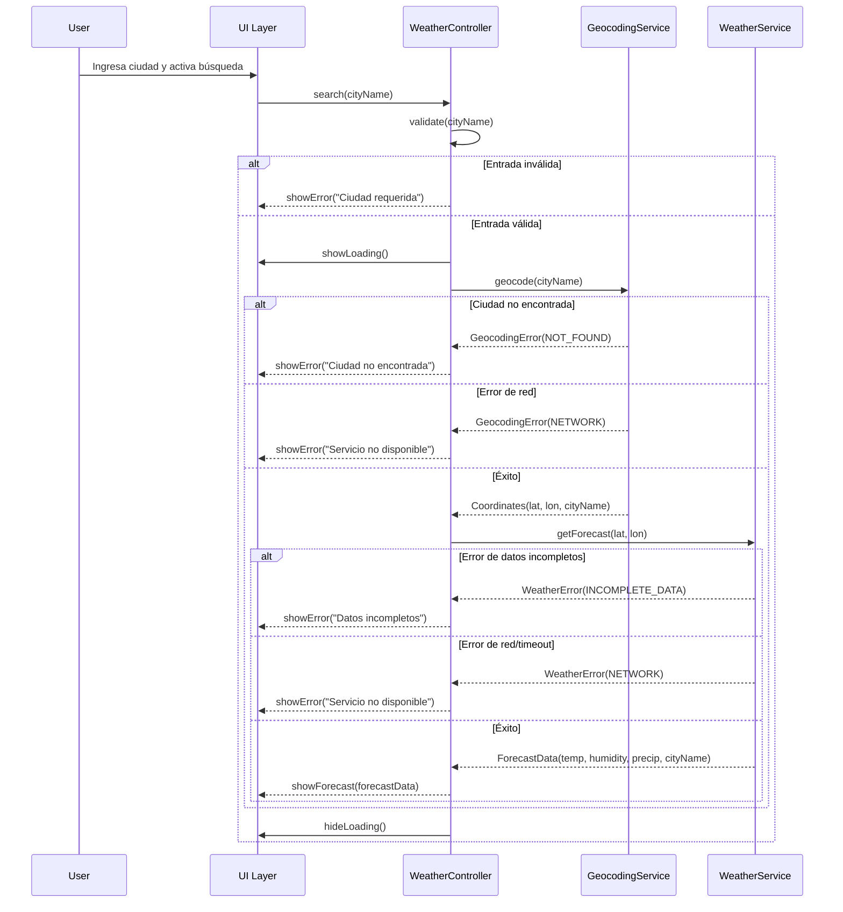
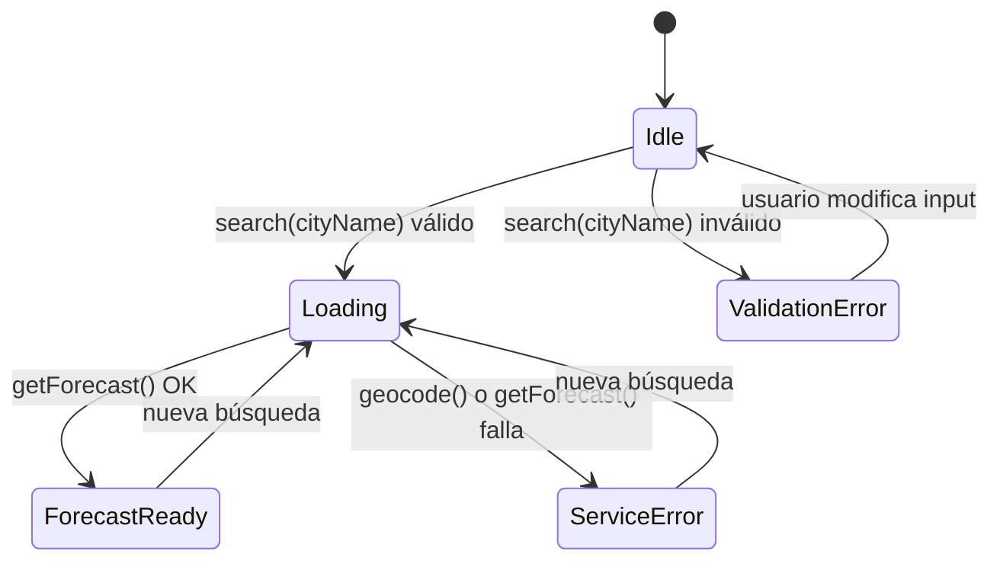

# Design Document

## Overview

La aplicación **Weather Forecast App** es una Single Page Application (SPA) web que permite al usuario consultar el pronóstico meteorológico actual de cualquier ciudad del mundo. El flujo principal es:

1. El usuario escribe el nombre de una ciudad en un campo de texto y activa la búsqueda.
2. La app llama a la [Geocoding API de Open-Meteo](https://geocoding-api.open-meteo.com/v1/search) para convertir el nombre en coordenadas geográficas (latitud/longitud).
3. Con las coordenadas obtenidas, la app llama a la [Weather Forecast API de Open-Meteo](https://api.open-meteo.com/v1/forecast) solicitando temperatura actual, humedad relativa y precipitación.
4. Los resultados se muestran en un panel de pronóstico claro y accesible.

No se requiere autenticación ni API key para usar las APIs de Open-Meteo en uso no comercial. La aplicación es puramente client-side (no necesita servidor propio), lo que simplifica el despliegue.

---

## Architecture

La aplicación sigue una arquitectura de tres capas lógicas dentro del cliente:

```
┌─────────────────────────────────────────────────────┐
│                    UI Layer                          │
│  SearchBar · LoadingIndicator · ErrorMessage ·       │
│  ForecastPanel                                       │
└──────────────────────┬──────────────────────────────┘
                       │ user events / state updates
┌──────────────────────▼──────────────────────────────┐
│                 Application Layer                    │
│  WeatherController (orchestrates search flow)        │
│  InputValidator · StateManager                       │
└──────────┬───────────────────────┬──────────────────┘
           │                       │
┌──────────▼──────────┐  ┌─────────▼─────────────────┐
│   Geocoding Service │  │    Weather Service          │
│  GeocodingAPI       │  │    WeatherAPI               │
│  (Open-Meteo Geo)   │  │    (Open-Meteo Forecast)    │
└─────────────────────┘  └────────────────────────────┘
```

**Flujo de datos:**



---

## Components and Interfaces

### UI Components

#### `SearchBar`
Contiene el `City_Input` y el `Search_Button`. Emite el evento `onSearch(cityName: string)` cuando el usuario activa la búsqueda (botón o tecla Enter). Limita el input a 100 caracteres. Oculta el error de validación en cuanto el usuario modifica el contenido del campo.

**Props/State:**
- `isLoading: boolean` — deshabilita el botón mientras hay una solicitud en curso.
- `validationError: string | null` — muestra/oculta el mensaje de validación local.

#### `LoadingIndicator`
Indicador visual (spinner o barra de progreso) que se muestra mientras cualquier solicitud HTTP está en curso.

**Props:**
- `visible: boolean`

#### `ErrorMessage`
Área fija entre la barra de búsqueda y el panel de pronóstico. Muestra el error actual con un fondo/borde visualmente distinto al `ForecastPanel`. Incluye la causa del fallo y la acción sugerida al usuario.

**Props:**
- `message: string | null` — si es `null`, el componente no se renderiza.

#### `ForecastPanel`
Panel que presenta los datos meteorológicos al usuario.

**Props:**
- `data: ForecastData | null` — si es `null`, el panel no se renderiza.

Muestra:
- Nombre de la ciudad
- Temperatura en °C
- Humedad relativa en %
- Precipitación en mm

### Application Layer Interfaces

```typescript
// Resultado de la geocodificación
interface Coordinates {
  latitude: number;
  longitude: number;
  cityName: string;      // nombre canoníco devuelto por la Geocoding API
}

// Datos del pronóstico
interface ForecastData {
  cityName: string;
  temperatureCelsius: number;
  relativeHumidityPercent: number;
  precipitationMm: number;
}

// Tipos de error
type GeocodingErrorKind = 'NOT_FOUND' | 'NETWORK';
type WeatherErrorKind   = 'INCOMPLETE_DATA' | 'NETWORK';

// Estado global de la aplicación
interface AppState {
  isLoading: boolean;
  validationError: string | null;   // error de input (campo vacío)
  serviceError: string | null;      // error de API (área de mensajes)
  forecast: ForecastData | null;
}
```

### Service Interfaces

#### `GeocodingService`

```typescript
interface GeocodingService {
  /**
   * Convierte un nombre de ciudad en coordenadas.
   * @throws GeocodingError si la ciudad no se encuentra o hay error de red.
   */
  geocode(cityName: string): Promise<Coordinates>;
}
```

Llama a `https://geocoding-api.open-meteo.com/v1/search?name={cityName}&count=1&language=es&format=json`.
Extrae `results[0].latitude`, `results[0].longitude` y `results[0].name`.

#### `WeatherService`

```typescript
interface WeatherService {
  /**
   * Obtiene el pronóstico actual para las coordenadas dadas.
   * @throws WeatherError si los datos están incompletos o hay error de red.
   */
  getForecast(coords: Coordinates): Promise<ForecastData>;
}
```

Llama a `https://api.open-meteo.com/v1/forecast?latitude={lat}&longitude={lon}&current=temperature_2m,relative_humidity_2m,precipitation`.
Extrae `current.temperature_2m`, `current.relative_humidity_2m` y `current.precipitation`.

#### `InputValidator`

```typescript
interface InputValidator {
  /** Devuelve null si válido, o un mensaje de error localizado si inválido. */
  validate(cityName: string): string | null;
}
```

Regla: inválido si `cityName.trim().length === 0`.

#### `WeatherController`

```typescript
interface WeatherController {
  /** Punto de entrada principal para la búsqueda. */
  search(cityName: string): Promise<void>;
}
```

Orquesta el flujo: validar → mostrar carga → geocodificar → consultar pronóstico → actualizar estado → ocultar carga.

---

## Data Models

### Geocoding API — Request

```
GET https://geocoding-api.open-meteo.com/v1/search
  ?name={cityName}
  &count=1
  &language=es
  &format=json
```

### Geocoding API — Response (éxito)

```json
{
  "results": [
    {
      "id": 2950159,
      "name": "Berlin",
      "latitude": 52.52437,
      "longitude": 13.41053,
      "country": "Deutschland",
      "timezone": "Europe/Berlin"
    }
  ]
}
```

Campos utilizados: `results[0].name`, `results[0].latitude`, `results[0].longitude`.
Si `results` está ausente o vacío → error `NOT_FOUND`.

### Geocoding API — Response (error HTTP)

```json
{
  "error": true,
  "reason": "..."
}
```

Código HTTP 4xx/5xx o error de red → error `NETWORK`.

---

### Weather API — Request

```
GET https://api.open-meteo.com/v1/forecast
  ?latitude={lat}
  &longitude={lon}
  &current=temperature_2m,relative_humidity_2m,precipitation
```

### Weather API — Response (éxito)

```json
{
  "latitude": 52.52,
  "longitude": 13.419998,
  "current_units": {
    "temperature_2m": "°C",
    "relative_humidity_2m": "%",
    "precipitation": "mm"
  },
  "current": {
    "time": "2024-01-15T12:00",
    "temperature_2m": 3.2,
    "relative_humidity_2m": 78,
    "precipitation": 0.0
  }
}
```

Campos utilizados: `current.temperature_2m`, `current.relative_humidity_2m`, `current.precipitation`.
Si alguno de los tres campos está ausente o no es numérico → error `INCOMPLETE_DATA`.
Si hay error de red, timeout (>10 s) o código HTTP no exitoso → error `NETWORK`.

---

### AppState (estado reactivo de la SPA)

| Campo | Tipo | Descripción |
|---|---|---|
| `isLoading` | `boolean` | Indica si hay una solicitud HTTP en vuelo |
| `validationError` | `string \| null` | Error de validación del input (campo vacío) |
| `serviceError` | `string \| null` | Error devuelto por los servicios externos |
| `forecast` | `ForecastData \| null` | Datos del último pronóstico exitoso |

**Transiciones de estado:**




---

## Correctness Properties

*A property is a characteristic or behavior that should hold true across all valid executions of a system — essentially, a formal statement about what the system should do. Properties serve as the bridge between human-readable specifications and machine-verifiable correctness guarantees.*

### Property 1: Límite de caracteres en el input

*Para cualquier* string de entrada del usuario, el valor almacenado en `City_Input` nunca debe superar los 100 caracteres; si el string tiene longitud ≤ 100 se almacena completo, si tiene longitud > 100 se almacena solo los primeros 100 caracteres.

**Validates: Requirements 1.3**

---

### Property 2: Rechazo de entradas vacías o de solo espacios

*Para cualquier* string compuesto únicamente de caracteres de espacio en blanco (incluyendo cadena vacía, espacios, tabulaciones, etc.), al activar la búsqueda el sistema debe rechazarla, mostrar el mensaje de error de validación, y no enviar ninguna solicitud a la Geocoding API.

**Validates: Requirements 1.5**

---

### Property 3: Editar el input limpia el error de validación

*Para cualquier* modificación al contenido de `City_Input` mientras se está mostrando un error de validación, el error de validación debe desaparecer inmediatamente tras la modificación.

**Validates: Requirements 1.6**

---

### Property 4: Cadena de llamadas API usa parámetros correctos

*Para cualquier* nombre de ciudad válido (con al menos un carácter no espaciado), la búsqueda debe: (a) llamar a la Geocoding API con exactamente ese nombre como parámetro; (b) si la geocodificación es exitosa, llamar a la Weather API con exactamente `latitude` y `longitude` extraídos de `results[0]` de la respuesta de geocodificación; y (c) incluir en la llamada a Weather API las tres variables `temperature_2m`, `relative_humidity_2m` y `precipitation`.

**Validates: Requirements 2.1, 2.2, 2.3, 3.1**

---

### Property 5: Ciclo de vida del indicador de carga

*Para cualquier* búsqueda iniciada (independientemente de su resultado: éxito, ciudad no encontrada, error de red o datos incompletos), el indicador de carga debe estar visible durante toda la solicitud HTTP y debe ocultarse una vez que la solicitud termina, sin excepción.

**Validates: Requirements 2.6, 3.5, 5.5**

---

### Property 6: Extracción correcta de datos de pronóstico

*Para cualquier* respuesta válida de la Weather API que contenga valores numéricos para `temperature_2m`, `relative_humidity_2m` y `precipitation`, los valores del `ForecastData` resultante deben ser iguales a los valores presentes en `current.temperature_2m`, `current.relative_humidity_2m` y `current.precipitation` respectivamente.

**Validates: Requirements 3.2**

---

### Property 7: Respuesta incompleta de Weather API muestra error

*Para cualquier* respuesta de la Weather API en la que al menos uno de los campos `temperature_2m`, `relative_humidity_2m` o `precipitation` esté ausente o no sea numérico, el sistema debe mostrar un mensaje de error de datos incompletos y no renderizar el `ForecastPanel`.

**Validates: Requirements 3.3, 4.6**

---

### Property 8: ForecastPanel renderiza todos los campos con unidades correctas

*Para cualquier* objeto `ForecastData` válido, el `ForecastPanel` renderizado debe incluir: el nombre de la ciudad, la temperatura expresada con la unidad °C, la humedad relativa expresada como porcentaje (0-100%), y la precipitación expresada en mm con valor ≥ 0.0.

**Validates: Requirements 4.1, 4.2, 4.3, 4.4**

---

### Property 9: Nueva búsqueda reemplaza el pronóstico anterior

*Para cualquier* par de búsquedas secuenciales con resultados exitosos distintos, el `ForecastPanel` visible tras completar la segunda búsqueda debe mostrar exclusivamente los datos de la segunda respuesta.

**Validates: Requirements 4.5**

---

### Property 10: Estado del botón refleja el estado de carga

*Para cualquier* estado de carga (`isLoading = true`), el `Search_Button` debe estar deshabilitado; y para cualquier estado no-carga (`isLoading = false`), el `Search_Button` debe estar habilitado.

**Validates: Requirements 5.4, 5.5**

---

### Property 11: Nueva búsqueda limpia el error anterior

*Para cualquier* estado con error de servicio previo, al activar una nueva búsqueda el mensaje de error anterior debe limpiarse antes de iniciar la nueva solicitud HTTP.

**Validates: Requirements 5.2**

---

### Property 12: Mensajes de error incluyen causa y acción sugerida

*Para cualquier* tipo de error que pueda producir la aplicación (validación, ciudad no encontrada, servicio de geocodificación no disponible, servicio meteorológico no disponible, datos incompletos), el mensaje de error mostrado debe contener tanto la descripción de la causa como una indicación de la acción que el usuario puede tomar para resolverlo.

**Validates: Requirements 5.7**

---

## Error Handling

### Estrategia general

Todos los errores se canalizan a través del `WeatherController` y se clasifican en dos categorías:

1. **Errores de validación** (`validationError`): generados por `InputValidator` antes de cualquier llamada de red. Se muestran inline junto al `City_Input` y se limpian al modificar el campo.

2. **Errores de servicio** (`serviceError`): generados por `GeocodingService` o `WeatherService`. Se muestran en el área fija `ErrorMessage` entre la barra de búsqueda y el `ForecastPanel`.

### Tabla de errores

| Condición | Tipo | Mensaje al usuario (es) | Acción sugerida |
|---|---|---|---|
| Input vacío o solo espacios | Validación | "El nombre de la ciudad es requerido." | Escribe el nombre de una ciudad. |
| Geocoding API sin resultados | Servicio | "No se encontró la ciudad ingresada." | Verifica el nombre y vuelve a intentarlo. |
| Geocoding API error de red/HTTP | Servicio | "El servicio de geocodificación no está disponible." | Verifica tu conexión a internet e inténtalo de nuevo. |
| Weather API timeout (>10 s) o error de red/HTTP | Servicio | "El servicio meteorológico no está disponible." | Verifica tu conexión a internet e inténtalo de nuevo. |
| Weather API datos incompletos | Servicio | "Los datos meteorológicos recibidos están incompletos." | Inténtalo de nuevo en unos momentos. |

### Timeout

La solicitud a la Weather API debe configurarse con un timeout de 10 segundos. Si la solicitud no recibe respuesta en ese plazo, se trata como un error de red (`NETWORK`).

### Limpieza de errores

- El `serviceError` se limpia al inicio de cada nueva búsqueda (antes de la primera llamada HTTP).
- El `validationError` se limpia cuando el usuario modifica el contenido del `City_Input`.

---

## Testing Strategy

### Enfoque dual

La estrategia de testing combina:

- **Tests de ejemplo (unit tests)**: verifican comportamientos específicos, casos de borde conocidos y flujos de integración entre componentes.
- **Tests de propiedad (property-based tests)**: verifican invariantes universales sobre espacios de entrada amplios o infinitos.

Ambos tipos son complementarios: los tests de ejemplo documentan comportamientos concretos, mientras los tests de propiedad detectan casos extremos inesperados.

### Biblioteca de property-based testing

Se utilizará **[fast-check](https://fast-check.dev/)** para JavaScript/TypeScript, la biblioteca de PBT más madura del ecosistema. Configuración mínima de **100 iteraciones** por test de propiedad.

Cada test de propiedad debe llevar un comentario de trazabilidad:

```typescript
// Feature: weather-forecast-app, Property N: <texto de la propiedad>
```

### Unit Tests (tests de ejemplo)

| Área | Escenario |
|---|---|
| `InputValidator` | Input vacío → error; Input con solo espacios → error; Input con un carácter → válido |
| `GeocodingService` | Respuesta con `results` vacío → `NOT_FOUND`; HTTP 500 → `NETWORK`; Error de red → `NETWORK` |
| `WeatherService` | Timeout superado → `NETWORK`; HTTP 404 → `NETWORK`; campo `temperature_2m` ausente → `INCOMPLETE_DATA` |
| `WeatherController` | Flujo completo exitoso; error en geocodificación limpia loading; error en weather limpia loading |
| UI | Search_Button deshabilitado mientras loading; ErrorMessage visible con texto correcto; ForecastPanel no visible en error |
| Integración (Enter key) | Presionar Enter llama al mismo handler que el botón |

### Property Tests

Cada test de propiedad corresponde a una propiedad del diseño:

| Propiedad | Librería | Generador clave | Mínimo de iteraciones |
|---|---|---|---|
| P1: Límite de 100 chars | fast-check | `fc.string({ maxLength: 200 })` | 100 |
| P2: Rechazo de solo-espacios | fast-check | `fc.stringOf(fc.constantFrom(' ', '\t', '\n', '\r'))` | 100 |
| P3: Editar input limpia error | fast-check | `fc.string({ minLength: 1 })` | 100 |
| P4: Cadena de llamadas API con parámetros correctos | fast-check | `fc.record({ lat: fc.float(), lon: fc.float(), name: fc.string() })` | 100 |
| P5: Ciclo de vida del indicador de carga | fast-check | `fc.oneof(successResponse, notFoundResponse, networkError)` | 100 |
| P6: Extracción correcta de datos de pronóstico | fast-check | `fc.record({ temp: fc.float(), humidity: fc.integer({ min:0, max:100 }), precip: fc.float({ min:0 }) })` | 100 |
| P7: Respuesta incompleta → error | fast-check | Respuestas con subconjuntos de campos faltantes | 100 |
| P8: ForecastPanel renderiza campos con unidades | fast-check | `fc.record({ cityName: fc.string(), ... })` de ForecastData | 100 |
| P9: Nueva búsqueda reemplaza pronóstico anterior | fast-check | `fc.tuple(forecastDataArb, forecastDataArb)` | 100 |
| P10: Estado del botón refleja isLoading | fast-check | `fc.boolean()` como estado de carga | 100 |
| P11: Nueva búsqueda limpia error anterior | fast-check | `fc.constantFrom(...errorTypes)` | 100 |
| P12: Mensajes de error incluyen causa y acción | fast-check | `fc.constantFrom(...allErrorKinds)` | 100 |
